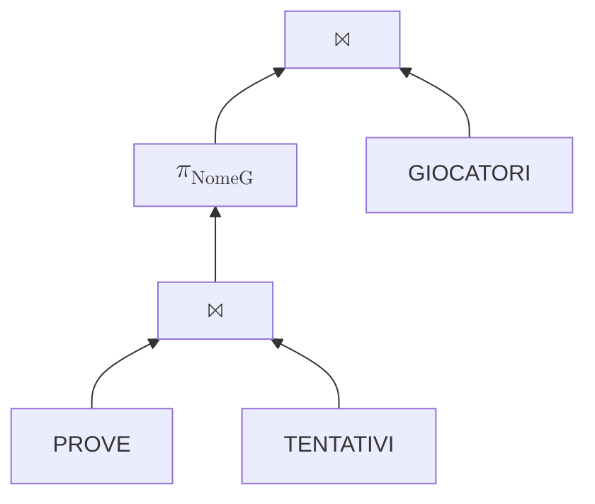
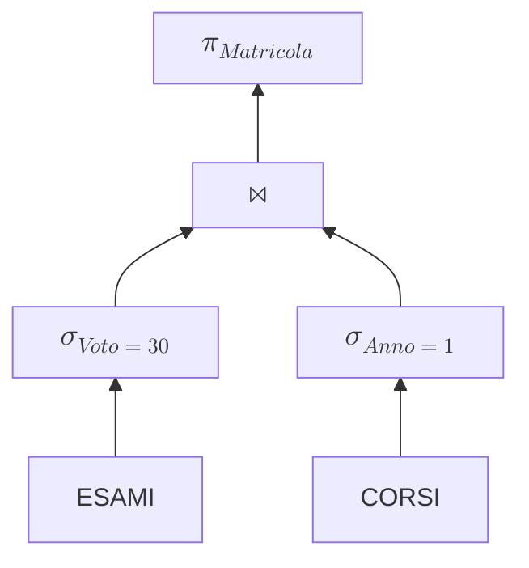
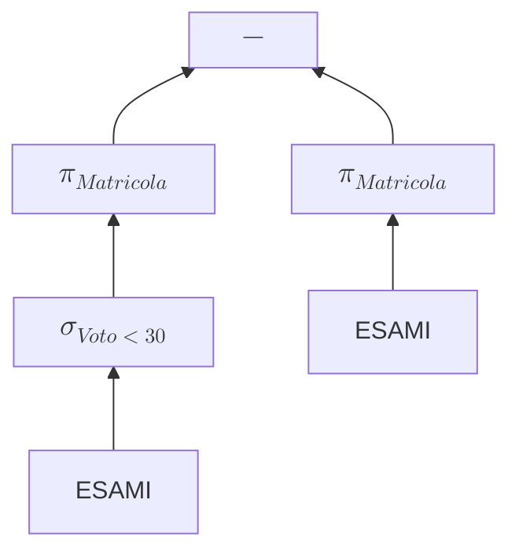
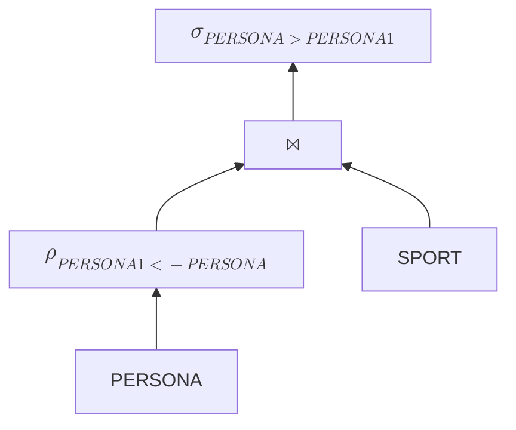

L'algebra relazionale è un linguaggio di manipolazione dati; le operazioni in questo linguaggio sono chiuse rispetto ad esso (operando tra due relazioni, si ottiene una relazione nello stesso insieme), è procedurale.

## Operatori

Ogni operatore deve stabilire come lo schema del risultato si costruisce a partire da quelli degli operandi e in che modo l'istanza risultato dipende da quelle in ingresso.

### Operatore Selezione $\sigma$

L'operatore $\sigma$, detto *di selezione*, è un operatore unario che permette di selezionare un sottoinsieme delle tuple di una relazione, applicandovi una formula di algebra booleana $F$.

$$
 \sigma_{F}(R) 
$$

- F si compone di predicati connessi da `AND` ($ $), `OR` ($ $) e `NOT` ($\neg$) operatori booleani (con associate proprietà note)
- Casi più comuni: un predicato è del tipo A  c o A  B, dove:
    - A e B sono attributi in X, $c \in dom(A)$ è una costante
    -  è un operatore di confronto,   {=, ≠, <, >, ≤, ≥} 

:::nota
$$ 
\sigma_{F_1 AND F_2}(E) \equiv \sigma_{F_1}(\sigma_{F_2}(E))  
$$
:::

### Operatore di Proiezione $\ \pi$

L'operatore $\sigma$, detto *di selezione*, è un operatore unario che permette di selezionare un sottoinsieme $Y$ degli attributi di una relazione:

$$
 \pi_Y(R) 
$$

L'operazione di proiezione elimina eventuali duplicati qualora non selezionasse come sottoinsieme di attributi una superchiave.

:::nota
$$ 
\pi_{Y}(\pi_{YZ}(E)) \equiv \pi_{Y}(E)  
$$
Eliminare attributi da una selezione in più passaggi o in uno solo non altera il risultato finale.
:::

:::nota
$$ 
\pi_{Y}(\sigma_{F}(E)) \equiv \sigma_{F}(\pi_{Y}(E))  
$$
Proiezione e Selezione sono commutative l'una rispetto all'altra.
:::

### Operatore di Join $\ \Join$

L'operatore di join naturale è un operatore binario e combina tuple di due relazioni sulla base dell'uguaglianza di valori degli attributi comuni alle due relazioni; lo schema del risultato è l'unione degli schemi degli operandi.

Ad esempio, se due tuple condividono un attributo 'A', il join creerà una nuova relazione combinando gli attributi delle due operande in cui sono presenti le tuple formate dall'unione delle tuple degli operandi che hanno lo stesso valore per l'attributo comune.

Le tuple dei due operandi che non hanno un "match" nell'altra relazione sono dette *dangling* e non figurano nel risultato.

La relazione risultante ha cardinalità compresa tra $0$ (tutte tuple dangling per entrambe le relazioni) e $|r_1| \times |r_2|$ (tutte le tuple su una relazione hanno match con tutte le tuple dell'altra).

Il join è un'operazione che gode delle proprietà commutativa e associativa, cioè, l'ordine con cui vengono eseguite le operazioni di join tra di loro è indifferente.

Qualora le relazioni avessero lo stesso schema (stessi attributi), allora il join equivarrebbe all'intersezione delle due.

In caso di mancanza di attributi comuni tra le due relazioni, il join naturale equivale al prodotto Cartesiano.

:::eg
Date 3 relazioni:
```
GIOCATORI(NomeG,Società);
PROVE(IdProva,MinPunti);
TENTATIVI(NomeG,IdProva,Data,Punti),
    NomeG REFERENCES GIOCATORI,
    IdProva REFERENCES PROVE;
```


1. PROVE $\Join$ TENTATIVI: (NomeG,IdProva,Data,Punti,MinPunti)
2. $\sigma_{\text{Punti} \geq \text{MinPunti}}$: prende le tuple con punti sufficienti
3. $\pi_{\text{NomeG}}$: prendiamo solo i nomi dei giocatori (duplicati collassano)
4. $\Join$ GIOCATORI: dati dei giocatori che hanno raggiunto il numero minimo di punti
:::

## Operatore Unione e Differenza

$\cup$ rappresenta l'unione logica.

$-$ rappresenta la differenza (cioè solo gli elementi che sono nel primo e non nel secondo).

L'intersezione si ottiene come $r_1 \cap r_2 = r_1 - (r_1 - r_2)$

:::eg
```
ESAMI(Matricola,CodCorso,Voto,Lode)
STUDENTI(Matricola)
```


---

Vogliamo trovare tutti gli studenti che hanno sempre preso 30, quindi dobbiamo fare in modo che le condizioni agiscano su un sottogruppo (ovvero raggruppare le tuple per Matricola e verificare che le tuple di ciascun gruppo abbiano come Voto tutti 30)

A livello logico possiamo *cercare il contrario*:
troviamo tutte le tuple che hanno un voto minore di 30 e prendiamo le Matricole: abbiamo ottenuto tutti quelli che dobbiamo escludere dal gruppo target



La stessa logica "inversa" può essere applicata per la ricerca delle matricole che *non hanno mai preso 30*: troviamo prima quelle che ne hanno preso almeno uno e poi le escludiamo dal gruppo.
:::

## Operatore di Ridenominazione $\ \rho$

Modifica lo schema di una relazione cambiando i nomi di uno o più attributi.

$$
\rho_{NomeNuovo <- NomeVecchio}
$$

:::eg 
Creiamo una versione rinominata di PERSONA
PERSONA1 | SPORT
 --- | ---
Anna | Nuoto
Anna | Volley
Luca | Nuoto

PERSONA | SPORT
 --- | ---
Anna | Nuoto
Anna | Volley
Luca | Nuoto

Il join su SPORT accoppierebbe però le persone anche con sé stesse

PERSONA | PERSONA1 | SPORT
 --- | --- | ---
Anna | Anna | Nuoto
Anna | Luca | Nuoto
Anna | Anna | Volley
Luca | Luca | Nuoto
Luca | Anna | Nuoto

Filtrare via quelli con PERSONA = PERSONA1 non sarebbe sufficiente,
perché avremmo ancora le coppie simmetriche per SPORT, serve prendere 1 simmetrico per nome


:::

## Viste

Una vista è una espressione a cui viene assegnato un nome e può essere usata come ogni altra relazione.

:::eg
Data la relazione:
```
QUOTE(ID,SOCIO,NUMAZIONI)
```
Dobbiamo verificare che per la stessa società (indicata con ID) due soci siano piazzati in ordine crescente di azioni (NUMAZIONI);

Prima troviamo le coppie che hanno almeno una società in comune:
```
QUOTE --> J
QUOTE --> \rho S,NA <- SOCIO,NUMAZIONI --> J // Rinominiamo
J --> \sigma SOCIO <> S // Togliamo le identità
\pi SOCIO,NUMAZIONI,S,NA
```

Prendiamo questo risultato come una vista V

```
V1 --> \sigma NUMAZIONI > NA  --> \pi SOCIO,S 
V2 --> \sigma NUMAZIONI \leq NA --> \pi SOCIO,S --> -
```

<!-- ?? -->
:::

:::eg
GIOCATORI(NOME,TENTATIVO)
TENTATIVI(PROVA,DATA,PUNTI)
PROVE(NOME,PROVA,DATA,PUNTI)

Vogliamo trovare chi ha superato tutte le prove

1. Estraiamo tutte le prove superate (quelle non-superate non ci interessano) (> minPunti)
2. Adesso non ci servono né i PUNTI né la DATA, teniamo NOME e PROVA
3. Creaiamo una vista dal risultato: SUPERATE

1. Creaiamo una combinazione di tutti i giocatori e tutte le prove, così avremo una vista in cui tutti i giocatori sono accoppiati con tutte le prove
2. sottraiamogli SUPERATE => otteniamo le coppie gicatore-provaCheNonHaSuperato
3. proiettiamo i giocatori ed abbiamo tutti i giocatori che non hanno superato almeno una prova
4. prendiamo tutti i giocatori e togliamogli il risultato precedente: abbiamo tutti i giocatori che hanno superato tutte le prove

:::

## Operatore di Divisione $\ \div$

La divisione tra le relazioni r1(X1X2) e r2(X2) è il più grande insieme di tuple con schema X1 tale che, facendo il prodotto cartesiano con r2, ciò che si ottiene è una relazione contenuta in r1.

Cioè $ $, similmente a
7 \div 3 = 2 <=> 2 \times 3 \lt 7

:::nb
È strettamente necessario, per effettuare questa operazione, che 
- lo schema del divisore deve essere un sottoinsieme dello schema del divisore;
- il dividendo non contiene attributi non d'interesse
:::

:::nota
La divisione è un'operazione derivata, da 
```
R1 --> \pi X1 --> J
R2 --> J

J --> -
R1 --> -

* --> \pi X1 --> -
R1 --> \pi X1 --> -
```
:::

:::eg
```
Risultati(Team, Punti)
```
Vogliamo prendere i team che hanno il punteggio più alto

Dobbiamo confrontare i punteggi delle squadre, quindi ci servirà eseguire un self-join:
il join dovrà poi escludere i riflessivi sia di team che di punti (nel caso sarebbero aexequo) e quelli scambiati
:::
```
Risultati --> \rho_{T,P <- Team,Punti} --> J
Risultati --> J

J --> \sigma_{P > Punti}
```
Teniamo quindi solo le coppie in cui il team T ha più punti del Team;
questo elimina sia i team confrontati con loro stessi che quelli con T e Team scambiati

I Team sono tutti quelli che hanno perso almeno contro una squadra, quindi li eliminiamo dall'insieme delle squadre per ottenere quelle che vincono sempre:

```
Risultati --> \pi_{Team} --> -
V --> \pi_{Team} --> -
```

