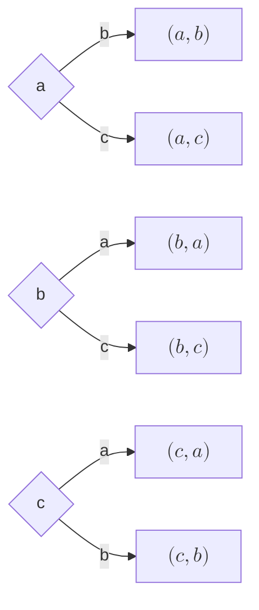

 
:::def{di Allineamento}
Chiamiamo **allineamento** un insieme ordinato di elementi.
:::

:::def{di Gruppo}
Chiamiamo in generale **gruppo** un insieme di elementi senza principio d'ordine
:::

## Principio di Enumerazione

Siano dati due esperimenti: il primo con $n$ possibili esiti e il secondo con $m$, allora il numero di coppie ordinate degli esiti degli esperimenti è $n \times m$.

:::eg
> Cerchiamo il numero di targhe automobiliste che è possibile creare. 

Una targa è composta da una sequenza ordinata di 4 lettere e 3 cifre, quindi esistono $26^4 \times 10^3$ casi.
:::

:::eg
> Consideriamo un insieme di 3 elementi $\{a,b,c\}$ e due esperimenti:
> 1. estrazione di una lettera a caso
> 2. estrazione di una lettera a caso dopo il primo esperimento (la lettera estratta non viene reimmessa nell'insieme).

Gli esiti possibili del primo esperimento sono $3$ come il numero di lettere nell'insieme, mentre per il secondo esperimento sono $2$.

Gli esiti combinati del primo e del secondo esperimento sono $6$:

:::

:::::oss
Il principio di enumerazione può essere usato per calcolare la probabilità di un certo evento di estrazione:
:::eg
> È data una scatola con $6$ palline rosse e $5$ blu. Vogliamo trovare la probabilità per cui si estragga prima una pallina blu e poi una rossa (senza reimmissione).

Il numero totale di casi è calcolabile facilmente come nell'esempio precedente:
$
n^o \text{ esiti possibili} = 
11 \times 10 =110
$,   
infatti, il colore non conta qui; ci sono 11 palline alla prima estrazione, 10 alla seconda, quindi gli esperimenti si possono risolvere in 110 modi.

Poi:
$
n^o \text{ esiti favorevoli} = 
5 \times 6 = 30 
$

La probabilità cercata è $P(E) = 30/110$.

Analogamente, la probabilità di estrarre una rossa e una blu in successione è $30/110$,   
la probabilità di estrarre due palline rosse di fila è $(6 \times (6-1) )/110 = 30/110$,   
la probabilità di estrarre due palline blu di fila è $(5 \times (5-1) )/110 = 20/110$.   
La probabilità totale è 1, perché questi sono tutti i casi possibili.

:::
:::::

## Disposizioni

Una disposizione di elementi è un sottoinsieme ordinato composto da quegli elementi estratto da un insieme più grande.

*In una disposizione è importante sia la composizione che la disposizione degli elementi*.

### Disposizioni Semplici

Dati $n$ elementi distinti, si definiscono **disposizioni *=u=semplici==* di $n$ elementi di classe $k$ (con $k \leq n$)**, tutti gli allineamenti che si possono formare prendendo $k$, con $k \leq n$, elementi dell'insieme degli $n$ *senza ripetizioni*.

$$ 
D_{n,k} = \frac{n!}{(n-k)!} 
$$

:::nota
Le disposizioni semplici sono associate alle estrazioni senza reimmissione.
:::

### Disposizioni con Ripetizione

Dati $n$ elementi distinti, si definiscono **disposizioni *=u=con ripetizione==* di $n$ elementi di classe $k$**, tutti gli allineamenti che si possono formare prendendo $k$ elementi, tutti con $k \leq n$ o $k \geq n$, anche con ripetizione, dell'insieme degli $n$.

$$ 
D_{n,k}^{R} = n^k 
$$

:::nota
Le disposizioni con ripetizione sono associate alle estrazioni con reimmissione.
:::

## Permutazioni

Una permutazione di elementi è il particolare ordinamento di tutti gli elementi disponibili in un insieme. 

*In una permutazione conta solo la disposizione degli elementi*.

### Permutazioni Semplici

Dati $n$ elementi distinti, si definiscono **permutazioni *=u=semplici==* degli $n$ elementi**, gli allineamenti che si possono formare con tali elementi.

$$ 
P_n = D_{n,n} = \frac{n!}{(n-n)!} = n! 
$$

:::oss
Possono essere considerate come un caso particolare delle disposizioni semplici.
:::

### Permutazioni con Ripetizione

Dati $n$ elementi, non necessariamente distinti, si definiscono **permutazioni *=u=con ripetizione==* degli $n$ elementi**, gli allineamenti che si possono formare con tali elementi.

Supponiamo che negli $n$ elementi compaiano $p$ elementi distinti, ciascuno con molteplicità $k_j$ dove $j$ rappresenta il $j$-esimo elemento distinto, per cui $n = \sum_{j=0}^{p} k_j$.
$$ 
P_{n}^R = \frac{n!}{
    \displaystyle\prod_{j=0}^{p}(k_j!)
} 
$$

## Combinazioni

Una combinazione di elementi è un sottoinsieme composto da quegli elementi estratto da un insieme più grande.

*In una combinazione conta solo la composizione degli elementi*.

### Combinazioni Semplici

Dati $n$ elementi distinti, si definiscono **combinazioni *=u=semplici==* di $n$ elementi di classe $k$ con $k \leq n$**, tutti i gruppi di $k$ elementi che si possono formare dagli $n$ dati *senza ripetizioni*.

Formula del coefficiente binomiale:
$$ 
C_{n,k} = \frac{n!}{(n-k)!\cdot k!} = \binom{n}{k} 
$$

### Combinazioni con Ripetizione

Dati $n$ elementi distinti, si definiscono **combinazioni *=u=con ripetizione==* di $n$ elementi di classe $k$ con $k \leq n$**, tutti i gruppi di $k$ elementi che si possono formare dagli $n$ dati *anche con ripetizioni*.

$$
C_{n,k}^{R} = \frac{(n+k-1)!}{k!(n-1)!}
$$

## Paradosso dei Compleanni

> Dato un gruppo di $n$ persone, nate nello stesso anno (non bisestile, quindi di 365 giorni):
> Vogliamo trovare la probabilità che ci siano almeno due persone con lo stesso giorno di compleanno.
> Supponiamo che la probabilità di essere nati un certo giorno dell'anno sia la stessa per tutti, indifferentemente dal giorno specifico.

Per ricercare l'evento in cui due o più persone siano nate lo stesso giorno, conviene calcolare la probabilità dell'evento complementare: sia dunque $C$ l'evento in cui tutte le $n$ persone hanno compleanni diversi, la cui probabilità è
$$ 
P(C) = \frac{n^o \text{ esiti di }C}{n^o \text{ esiti totali}}
$$

Anche in un gruppo numeroso, è ammesso che tutti abbiano la stessa data di compleanno, cioè, ipotizzando l'assegnazione di un compleanno come l'estrazione di una data, allora è un'estrazione con reimmissione.

Per il principio di enumerazione, essendo 365 i giorni possibili per un compleanno (secondo le ipotesi), *le possibili combinazioni di date di compleanno sono $365^n$*.

Gli esiti di $C$ richiedono che tutti quelli che "pescano" il proprio compleanno, non estraggano uno di quelli già estratti ($365/365$ buoni per il primo, $364/365$ per il secondo, $363/365$ per il terzo e così via);
troviamo che
$$
n^o \text{ esiti di }C = D_{365,n} = \frac{365!}{(365-n)!}
$$

Per cui 
$$
P(C) = \frac{365!}{(365-n)! 365^n}
$$

L'evento complementare $C^C$, quello di cui volevamo calcolare la probabilità, è quindi
$$
P(C^C) = 1 - \frac{365!}{(365-n)! 365^n}
$$

:::oss
Come prevedibile, è impossibile richiedere che due persone in un gruppo di 366 o superiore non abbiano mai lo stesso compleanno. 

Quello che stupisce è che la probabilità di avere compleanni coincidenti cresce molto rapidamente, assestandosi addirittura al 90% per un gruppo di sole 40 persone. 

Questa crescita rapida è il motivo per cui questo problema è chiamato "paradosso" (non è un paradosso logico; semplicemente, contraddice l'intuito).
:::

## Esempi di Estrazione

> Sia data una scatole con 6 palline rosse e 5 blu di cui se ne estraggono 3:
:::::ol

:::li
> Qual è la probabilità di estrarre prima una pallina rossa e poi 2 blu, una alla volta e in ordine con reimmissione?

Chiamiamo $A$ l'evento di estrazione di una pallina rossa e due palline blu in ordine con reimmissione, quindi
$$ 
P(A) = \frac{n^o \text{ esiti di }A}{n^o \text{ esiti totali}} = \frac{n_A}{N} 
$$
Trattasi di una disposizione con ripetizione di 11 oggetti, di cui ne estraiamo 3: $N = 11^3$.

Le palline rosse sono 6 e vanno estratte 1 volta, quelle blu 5 ed estratte 2: $n_A = 6 \times 5^2$ usando il principio di enumerazione,
oppure, possiamo vedere $n_A$ come le disposizioni con ripetizioni di 6 oggetti, di cui ne estraiamo 1 e di 5 oggetti, di cui ne estraiamo 2: $n_A = D_{6,1}^R \times D_{5,2}^R = 6 \times 5^2$.

Quindi $P(A) = 6\times5^2\div11^3 = 0,1127 = 11,27 \% $.
:::
:::li
> Qual è la probabilità di estrarre una pallina rossa e due blu senza badare all'ordine?

Riprendiamo la nomenclatura: 
$$ 
P(B) = \frac{n_B}{N} 
$$

$N$ rimane lo stesso, mentre $n_B$, si presentano 3 possibili variazioni di $n_A$, quindi $n_B = 3 \times 6 \times 5^2$ o $n_B = 3 \times D_{6,1}^R \times D_{5,2}^R = 6 \times 5^2$.
:::
:::li
> Qual è la probabilità di estrarre una pallina rossa e due blu nell'ordine e senza reimmissione?
$$ P(C) = \frac{n_C}{N} $$

Questo è un caso di combinazione: $ N = D_{11,3} = \binom{11}{3} = \frac{11!}{8!} = 11 \times 10 \times 9 \times 8! / 8! = 11 \times 10 \times 9 $

Mentre $n_C = D_{6,1} \times D_{5,2} = 6 \times 5 \times 4 $.
:::
:::li
> Qual è la probabilità di estrarre una pallina rossa e due blu senza ordine e senza reimmissione?
$$ P(D) = \frac{n_D}{N} $$

Si presentano due possibili modelli di estrazione:
- viene estratta una pallina per volta (esiste un ordine),
- vengono estratte tutte le palline insieme (non esiste alcun ordine)

Se estraiamo una pallina alla volta: 
$$ 
P(D) = \frac{3 \times D_{6,1} \times D_{5,2}}{D_{11,3}} 
$$

Se estraiamo tutte insieme: 
$$
P(D) = \frac{C_{6,1} \times C_{5,2}}{C_{11,3}} 
$$

Alla fine, per tutti e due i casi, il risultato è il medesimo.
:::
:::::