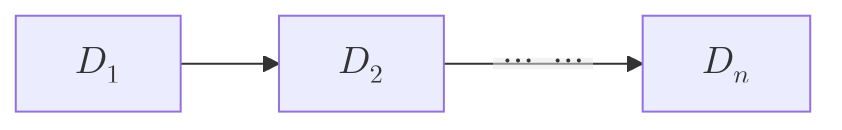

## Dispositivi in Serie

> Data una serie di $n$ dispositivi in serie, ciascuno indipendente dagli altri, sia $D_k$ l'evento in cui il dispositivo $k$-esimo funzioni, con $D_1$,$D_2$...$D_n$ tutti indipendenti, sia la probabilità $p_k=P(D_k)$ che il dispositivo $k$-esimo funzioni
>
> Vogliamo conoscere la probabilità di $E$, evento in cui l'intero sistema funzioni.

Abbiamo 

$$
P(E) 
= \bigcap_{k=1}^n P(D_k) 
= \prod_{k=1}^n p_k
$$

## Dispositivi in Parallelo

> Data un sistema di $n$ dispositivi in parallelo, ciascuno indipendente dagli altri, sia $D_k$ l'evento in cui il dispositivo $k$-esimo funzioni, con $D_1$,$D_2$...$D_n$ tutti indipendenti, sia la probabilità $p_k=P(D_k)$ che il dispositivo $k$-esimo funzioni.
>
> Vogliamo conoscere la probabilità di $F$, evento in cui l'intero sistema funzioni, cosa che avviene se *almeno uno dei dispositivi funzioni*.

Per calcolare la probabilità $F$, conviene calcolare prima la probabilità dell'evento complementare $F^C$, cioè l'evento in cui nessuno dei dispositivi funzioni, che prevede un'unica casistica:

$$
\begin{aligned}
P(F) &= 1 - P(F^C) \\[8pts]
&= 1 - P(D^c_1 \cap D^c_2 \ldots D^c_n) = \\[8pts]
&= 1 - P(D^c_1)P(D^c_2)\ldots P(D^c_n) 
\end{aligned}
$$

:::nota
se $F = \bigcup_{k=1}^n D_k$

allora $F^C = (\bigcup_{k=1}^n D_k)^C = \bigcap_{k=1}^n D^c_k$

quindi, del caso precedente

$$
\begin{aligned}
P(F) &= 1 - P(D^c_1 \cap D^c_2 \ldots ) = \\[8pts]
&= 1 - P\left(\left(\bigcup_{k=1}^n D_k\right)^C\right)
\end{aligned}
$$
:::

## Problema della Rovina del Giocatore

> A e B giocano lanciando una moneta:
> - se esce "testa", allora B dà ad A una moneta, 
> - se esce "croce", allora B riceve da A una moneta
> Il gioco prosegue finchè entrambi i giocatori hanno almeno una moneta
>
> Inizialmente A ha $k$ monete, con $k \geq 1$ e $k < n$ e B ha $n-k$ monete (cioè le rimanenti)
>
> Vogliamo conoscere la probabilità che A vinca (o viceversa, che avvenga la rovina di B).

:::nota
Dobbiamo partire con la supposizione che il gioco possa iniziare (almeno una partita), quindi entrambi i giocatori devono avere almeno una moneta a testa.
:::

Sia $V$ l'evento in cui A vince la partita, $T$ che esca testa e $C$ che esca croce.

La probabilità che A vinca la possiamo ricavare tramite il teorema delle probabilità totali:
$$P(V) = P(V|T)P(T) + P(V|C)P(C)$$

Per ricavare il risultato è necessario conoscere il numero iniziale di monete.

Sia $p_k = P(V)$ la probabilità di vincere di A nel caso in cui inizi con $k$ monete, quindi
- $P(V|T) = p_{k+1}$ se esce "testa", cioè B dà ad A una moneta
- $P(V|C) = p_{k-1}$ se esce "croce", cioè il contrario di sopra

Siano $p=P(T)$ e $q=P(C)$, per cui è vero che $q = 1 - p$.

Sostituendo quanto trovato nella formula delle probabilità totali:
$$
p_k = p_{k+1}\,p + p_{k-1}\,q
$$
poichè $1 = p + q$:
$$
\begin{aligned}
p_k=(p+q)\,p_k = p_{k+1}\,p + p_{k-1}\,q \\
(p_{k-1} - p_k)\, p = (p_k-p_{k-1})\, q \\
p_{k+1} - p_k = \displaystyle\frac{q}{p}\, (p_k - p_{k-1})
\end{aligned}
$$

Vediamo le probabilità per $k$ diversi:

Sappiamo già che 
- se A inizia con tutte le monete, allora ha vinto in partenza: $p_n = 1$,
- viceversa, se A inizia senza monete, allora ha perso in partenza: $p_0 = 0$

Poi, possiamo procedere svolgendo le $k$ una ad una, siccome ogni versione dell'equazione $p_{k+1} - p_k = \displaystyle\frac{q}{p}\, (p_k - p_{k-1})$ referenzia quella precedente:

$$
\begin{aligned}
k = 1 &\Rightarrow &
p_2 - p_1 
&= \displaystyle\frac{q}{p}\, (p_1 - \underbrace{p_0}_{0}) 
= \displaystyle \frac{q}{p}\, p_1 
\\
k= 2 &\Rightarrow  &
p_3 - p_2 
&= \displaystyle\frac{q}{p} \underbrace{(p_2 - p_1)}_{\text{come }k=1} 
= \left(\displaystyle\frac{q}{p}\right)^2 p_1
\\
\vdots & & \vdots
\\
k = n-1 &\Rightarrow &
p_n - p_{n-1} 
&= \displaystyle\frac{q}{p} \underbrace{(p_{n-1} - p_{n-2})}_{\text{come }k=n-2}
= \left(\displaystyle\frac{q}{p}\right)^{n-1} p_1
\end{aligned}
$$

sommando tutte le equazioni otteniamo una serie:
$$
p_n - p_1 = 
\displaystyle\frac{q}{p}\, p_1 
+ \left(\displaystyle\frac{q}{p}\right)^2p_1 
+ \ldots 
+ \left(\displaystyle\frac{q}{p}\right)^{n-1}p_1
$$

Poichè $p_n=1$, possiamo raggruppare tutti gli addendi per $p_1$ ed ottenere un'equazione che dipende solo da $p$, $n$ e $p_1$:
$$
\begin{aligned}
1 &= p_1 
+ \displaystyle\frac{q}{p}\, p_1 
+ \left(\displaystyle\frac{q}{p}\right)^2p_1 
+ \ldots 
+ \left(\displaystyle\frac{q}{p}\right)^{n-1}p_1 =\\[10pt]
&= p_1 \,\left[1
    + \displaystyle\frac{q}{p}
    + \left(\displaystyle\frac{q}{p}\right)^2
    + \ldots 
    + \left(\displaystyle\frac{q}{p}\right)^{n-1}
\right] =\\[10pt]
&= p_1 \sum_{k=0}^{n-1} \left(\displaystyle\frac{q}{p}\right)^k \\
&\Downarrow\\
p_1 
&=
\frac{1}{\displaystyle\sum_{k=0}^{n-1} \left(\frac{q}{p}\right)^k}
\end{aligned}
$$

Possiamo ragionare in modo analogo per qualsiasi $k$, per cui
$$
\begin{aligned}
\displaystyle
p_{k+1} - p_k 

&= \frac{q}{p}\, (p_k - p_{k-1}) =\\

&= \left(\frac{q}{p}\right)^2 (p_{k-1} - p_{k-2}) =\\

&\ \ \vdots\\

&= \left(\frac{q}{p}\right)^k (p_{1} - \underbrace{p_0}_{0}) =\\

&= \left(\frac{q}{p}\right)^k p_{1}
\end{aligned}
$$
questa formula è analoga a quella ricavata per $p_n - p_{n-1}$;   
ripetendo i medesimi ragionamenti, troviamo che 

$$
\begin{aligned}

p_k - p_1 &= 
\displaystyle\frac{q}{p}\, p_1 
+ \left(\displaystyle\frac{q}{p}\right)^2p_1 
+ \ldots 
+ \left(\displaystyle\frac{q}{p}\right)^{k-1}p_1\\

&\Downarrow\\

p_k &= 
p_1 \sum_{j=0}^{k-1} \left(\displaystyle\frac{q}{p}\right)^j \\

\end{aligned}
$$

Possiamo ricavare che in generale

$$
p_k = 
\frac{
    1
    + \displaystyle\frac{q}{p}
    + \ldots
    + \left(\displaystyle\frac{q}{p}\right)^{k-1}
}{
    1
    + \displaystyle\frac{q}{p}
    + \ldots 
    + \left(\displaystyle\frac{q}{p}\right)^{n-1}
}
= \frac{
    \displaystyle
    \sum_{j=0}^{k-1} 
    \left(
        \frac{q}{p}
    \right)^j
}{
    \displaystyle
    \sum_{k=0}^{n-1} 
    \left(
        \frac{q}{p}
    \right)^k
}
$$

:::::ul
:::li
Se assumiamo che la moneta sia equilibrata ($50\%$ per ciascuna faccia), cioè $p = q$, allora:
$$
p_1 = \frac{1}{\displaystyle\sum_{k=0}^{n-1} \left(1\right)^k} 
= \frac1{n}
$$
e, analogamente $\ \displaystyle p_k = \frac{k}n $
:::
:::li
Nel caso in cui la moneta *non sia equilibrata*, cioè $ q \neq p$, abbiamo

$$
\begin{aligned}

p_1 &= \frac{1}{
    \displaystyle
    \sum_{k=0}^{n-1} 
    \left(
        \frac{q}{p}
    \right)^k
} \times\underbrace{
    \frac{ 1-\displaystyle\frac{q}{p}}{1- \displaystyle\frac{q}{p}}
}_1 =
\\

&=
\frac{
    1-\displaystyle\frac{q}{p}
}{  
    \displaystyle
    \left(1 - \frac{q}{p}\right)
    + \left[
        \frac{q}{p} 
        - \left(\frac{q}{p}\right)^2
    \right]
    + \ldots 
    + \left[
        \left(\frac{q}{p}\right)^{n-1}
        - \left(\frac{q}{p}\right)^{n}
    \right]
}
=\\[14pt]

&=  \frac{
    \displaystyle
    1-\frac{q}{p}
}{
    \displaystyle
    1 - \left(\frac{q}{p}\right)^n
}
\end{aligned}
$$

Concludendo, con ragionamento analogo, che
$$
p_k 
=  \frac{
    \displaystyle 
    1 - \left(\frac{q}{p}\right)^k
}{
    \displaystyle
    1 - \left(\frac{q}{p}\right)^n
}
$$

:::::